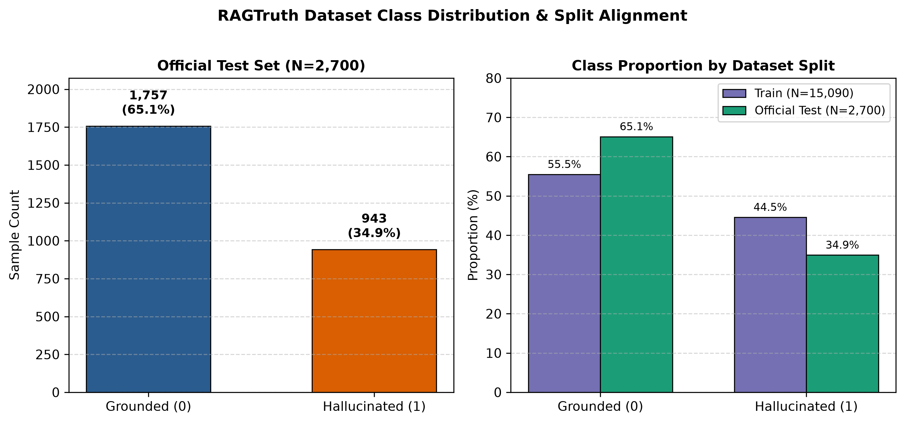
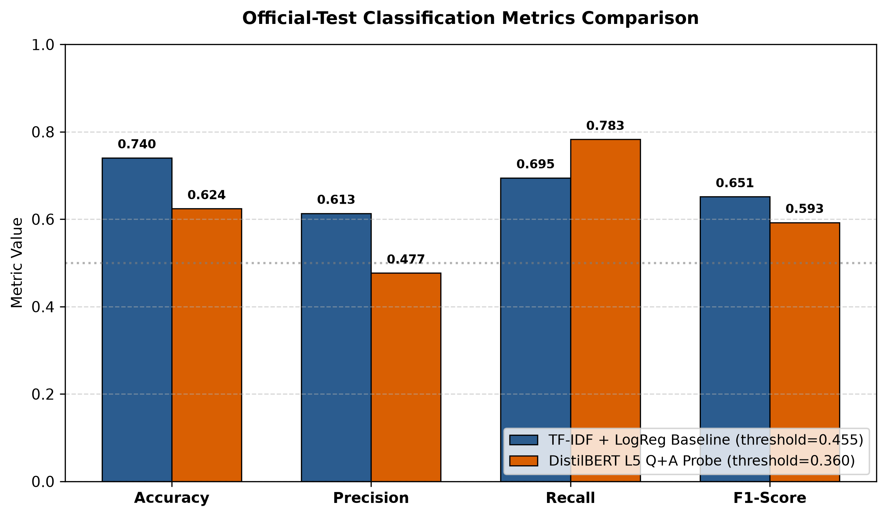
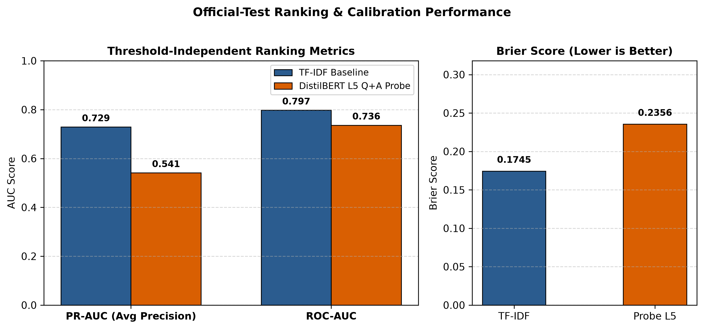
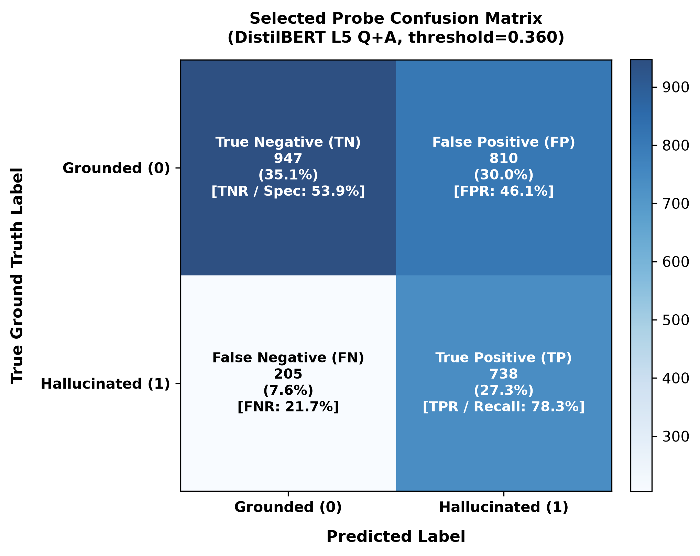
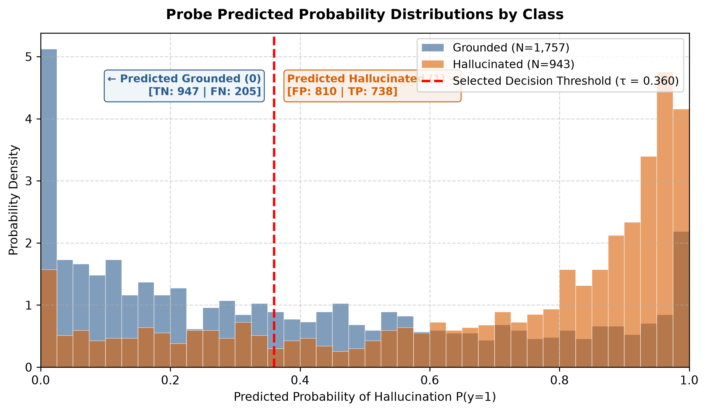
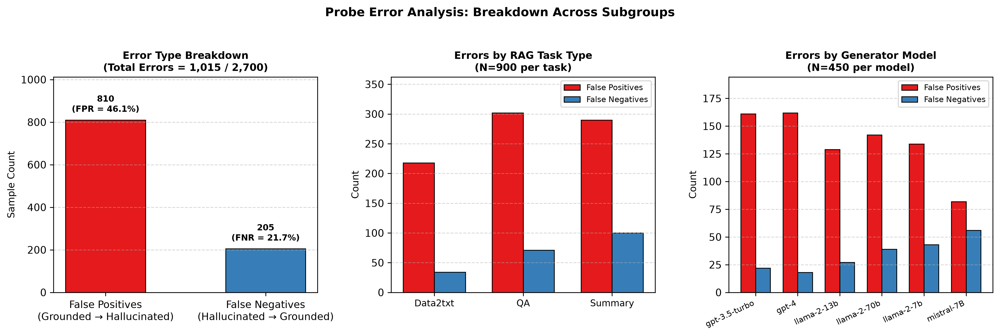
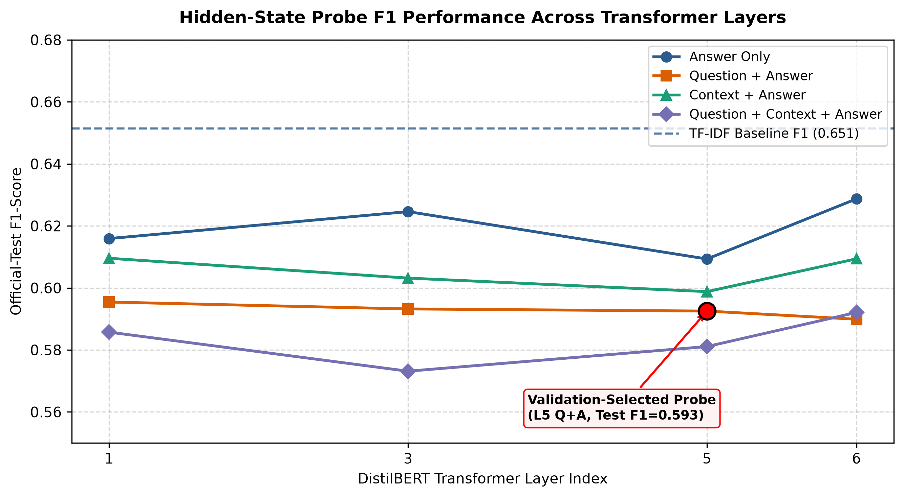
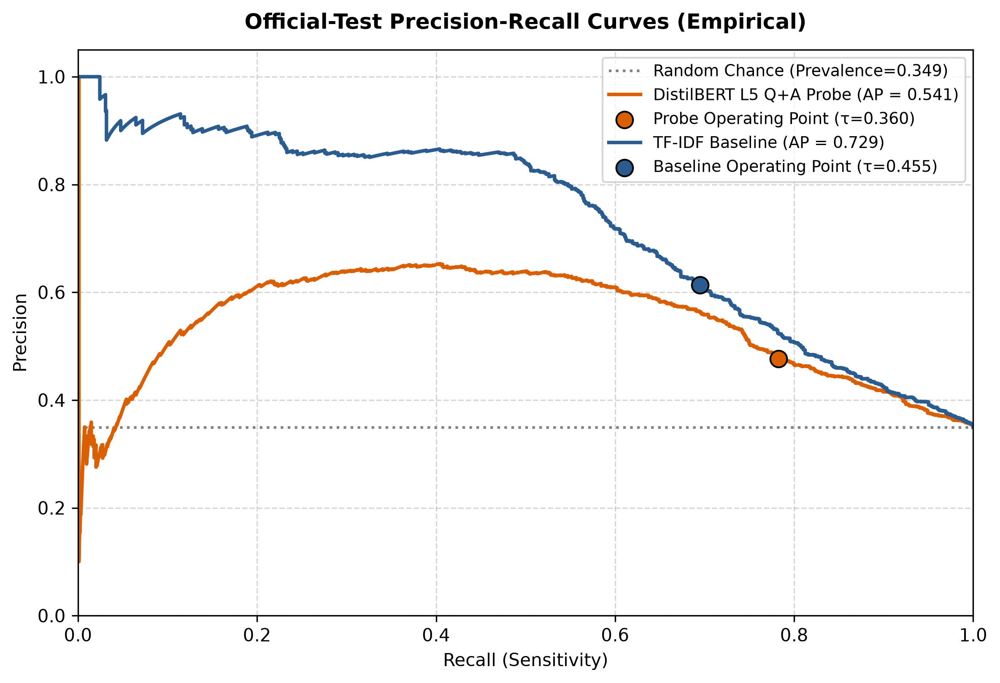

# RAGGuard Phase 2: Research-Grade Error Analysis and Evaluation Report

**Project Title:** RAGGuard — Hallucination Detection in RAG Answers Using Classical Probes on LLM Internals  
**Academic Context:** Advanced Machine Learning Lab, Integrated M.Sc. Artificial Intelligence and Machine Learning  
**Evaluation Split:** Official Test Split (`data/processed/ragtruth/test.csv`, N=2,700)  
**Report Generated:** Phase 2 Pipeline Execution  

---

## 1. Objective

This research report provides a rigorous, empirical error analysis of classical machine learning probes applied to transformer representations for hallucination detection in Retrieval-Augmented Generation (RAG) systems. Specifically, we evaluate a validation-selected Logistic Regression probe trained on observer-model representations from `distilbert/distilbert-base-uncased` across layers 0–6 against an established TF-IDF text-level baseline on the official, held-out RAGTruth test set.

The primary research questions addressed in this analysis are:
1. **Representational Fidelity:** Can observer-model internal representations (DistilBERT) reliably discriminate between grounded and hallucinated RAG responses?
2. **Error Modalities:** What specific error modes (False Positives vs. False Negatives) dominate the probe's predictions, and how do they distribute across generator LLMs and RAG tasks?
3. **Generalization Gap:** Does validation-based model selection (highest validation F1) generalize effectively to the official test distribution, or does a selection-generalization disparity emerge?
4. **Baseline Disparity:** Why does the surface-level TF-IDF baseline outperform the internal hidden-state probe across most global discrimination metrics, and what are the scientific implications for probe-based hallucination detection?

---

## 2. Dataset and Label Distribution

The evaluation is conducted on the benchmark RAGTruth dataset. The binary classification task is formally defined as:
- **Class 0 (Grounded / Non-Hallucinated):** The generated answer is factually consistent with and substantiated by the provided reference context.
- **Class 1 (Hallucinated):** The generated answer introduces unsupported claims, factual distortions, or context-contradicting entities.

### Official Test Set Composition
- **Total Samples:** 2,700 rows
- **Grounded Samples (Class 0):** 1,757 (65.07%)
- **Hallucinated Samples (Class 1):** 943 (34.93%)
- **Class Imbalance Ratio:** ~1.86 : 1 (Grounded to Hallucinated)

### Split Alignment Verification
- **Training Set (Pre-split):** 15,090 rows (8,369 Grounded [55.46%], 6,721 Hallucinated [44.54%])
- **Train Partition (80% Stratified):** 12,072 rows (6,695 Grounded, 5,377 Hallucinated)
- **Validation Partition (20% Stratified):** 3,018 rows (1,674 Grounded, 1,344 Hallucinated)

The official test set exhibits a lower proportion of hallucinations (34.93%) compared to the training set (44.54%), representing a mild natural distribution shift in class prevalence across splits.


*Figure 1: Class distribution of the RAGTruth official test split and comparison with training partition proportions.*

---

## 3. Experimental Setup and Observer-Model Semantics

### Critical Scientific Qualification: Observer-Model Architecture
The representations utilized in this study were extracted using `distilbert/distilbert-base-uncased` applied as an **external observer model** over the concatenated sequence components, where token hidden states are mean-pooled over attended tokens across layers 0 through 6.

> [!IMPORTANT]
> **Observer vs. Generator Representation:** These hidden states are **not** the internal activations of the generative models (e.g., GPT-4, LLaMA-2, Mistral) that produced the answers. They represent how a frozen, smaller encoder-only model encodes the surface text post-hoc. Consequently, this study evaluates whether an observer encoder possesses internal linear separability for hallucination detection, **not** whether generative LLMs internally 'know' when they are hallucinating.

### Experimental Protocol and Hygiene
- **Strict Data Isolation:** Official test labels and features were never accessed during model fitting, hyperparameter selection, or decision threshold calibration.
- **Scaling:** `StandardScaler` was fitted exclusively on the 12,072 training partition samples and applied to validation and test features within inference pipelines.
- **No Retraining:** All metrics and predictions analyzed herein are loaded directly from previously completed Phase 1 experiment runs.

---

## 4. Selected Probe Configuration

Model selection was conducted strictly on the 3,018-sample validation partition by maximizing validation F1 across all evaluated layer indices (1, 3, 5, 6), feature segments (`answer_only`, `question_answer`, `context_answer`, `question_context_answer`), and classifiers.

### Validation-Selected Architecture
- **Feature Segment:** `question_answer` (concatenation of mean-pooled question and answer representations)
- **Transformer Layer:** Layer 5 (penultimate layer of 6-layer DistilBERT)
- **Feature Dimension:** 1,536 (768 from question + 768 from answer)
- **Classifier:** Logistic Regression (L2 regularization)
- **Validation F1:** 0.700129
- **Validation-Selected Threshold (tau):** 0.3600

> [!NOTE]
> The selected probe configuration **does not ingest the reference context**. It relies entirely on the semantic representations of the question and the generated answer.

---

## 5. Baseline Comparison: Hidden-State Probe vs. TF-IDF Baseline

Table 1 summarizes official-test performance between the TF-IDF baseline and the validation-selected DistilBERT probe.

### Table 1: Official-Test Performance Summary

| Metric | TF-IDF Baseline | DistilBERT L5 Q+A Probe | Difference (Delta) | Superior System |
| :--- | :---: | :---: | :---: | :---: |
| **Accuracy** | **0.7404** | 0.6241 | -0.1163 | TF-IDF |
| **Precision** | **0.6133** | 0.4767 | -0.1366 | TF-IDF |
| **Recall (Sensitivity)** | 0.6946 | **0.7826** | +0.0880 | **Probe** |
| **F1-Score** | **0.6514** | 0.5925 | -0.0589 | TF-IDF |
| **Specificity (TNR)** | **0.7650** | 0.5390 | -0.2260 | TF-IDF |
| **Balanced Accuracy** | **0.7298** | 0.6608 | -0.0690 | TF-IDF |
| **False Positive Rate (FPR)** | **0.2351** | 0.4610 | +0.2259 | TF-IDF (Lower) |
| **False Negative Rate (FNR)** | 0.3054 | **0.2174** | -0.0880 | **Probe (Lower)** |
| **PR-AUC (Avg Precision)** | **0.7287** | 0.5412 | -0.1875 | TF-IDF |
| **ROC-AUC** | **0.7974** | 0.7359 | -0.0615 | TF-IDF |
| **Brier Score (Calibration)** | **0.1745** | 0.2356 | +0.0611 | TF-IDF (Lower) |
| **Decision Threshold (tau)** | 0.4550 | 0.3600 | -0.0950 | — |


*Figure 2: Official test classification metrics comparing TF-IDF baseline and DistilBERT L5 Q+A probe.*


*Figure 3: Ranking metrics (PR-AUC, ROC-AUC) and calibration metric (Brier score) comparison.*

---

## 6. Confusion Matrix and Error Metrics

The confusion matrix for the selected probe on the 2,700 official test samples is detailed in Table 2.

### Table 2: Selected Probe Confusion Matrix Breakdown

| Actual \ Predicted | Predicted Grounded (0) | Predicted Hallucinated (1) | Total Actual | Class Error Rate |
| :--- | :---: | :---: | :---: | :---: |
| **Actual Grounded (0)** | **TN = 947** (35.07%) | **FP = 810** (30.00%) | 1,757 | FPR = 46.10% |
| **Actual Hallucinated (1)** | **FN = 205** (7.59%) | **TP = 738** (27.33%) | 943 | FNR = 21.74% |
| **Total Predicted** | 1,152 (42.67%) | 1,548 (57.33%) | **2,700** | Total Errors = 1,015 |


*Figure 4: Detailed confusion matrix of the validation-selected DistilBERT probe.*


*Figure 5: Predicted probability density distributions for grounded and hallucinated classes, illustrating the decision threshold cut at tau=0.360.*

---

## 7. False-Positive Analysis

The probe produced **810 False Positives** out of 1,757 grounded samples (FPR = 46.10%). This represents the single largest source of model inaccuracy (79.80% of all misclassifications).

### Key Empirical Observations on False Positives:
1. **Threshold Effect:** The validation-selected decision threshold of tau = 0.360 is substantially lower than the standard 0.50. While this successfully elevated recall (78.26%), it aggressively shifted borderline cases into the positive (hallucinated) category, causing precision to drop to 47.67%.
2. **Context Blindness in Feature Space:** The selected probe uses `question_answer` features exclusively. Because the probe does not receive the reference context, it cannot verify whether an assertive factual claim made in the answer is grounded in the text. It must rely on stylistic cues (length, perplexity, confidence, syntactic hedges). Consequently, highly detailed, well-grounded answers are misclassified as hallucinations.
3. **Elevated False Positives on High-Capability Generators:**
   - **GPT-4-0613:** 162 False Positives (FPR = 50.31% of grounded GPT-4 answers)
   - **GPT-3.5-Turbo-0613:** 161 False Positives (FPR = 50.47% of grounded GPT-3.5 answers)
   Both frontier models produce fluent, confident, syntactically complex prose that the observer model's question-answer probe frequently misidentifies as hallucinated.

---

## 8. False-Negative Analysis

The probe produced **205 False Negatives** out of 943 hallucinated samples (FNR = 21.74%).

### Key Empirical Observations on False Negatives:
1. **Subtle Entity and Numerical Distortions:** In RAG settings, the most dangerous hallucinations are subtle: altering a date, swapping a named entity, or modifying a quantity while maintaining perfect grammatical fluency. Without cross-attending to the context tokens, the observer model's layer-5 representations encode plausible-sounding hallucinated answers identically to grounded answers.
2. **Task Distribution of False Negatives:**
   - **Summary Task:** 100 False Negatives (48.78% of all false negatives). In summarization, hallucinations frequently consist of subtle extrapolations beyond the source passage that appear entirely natural in the answer alone.
   - **QA Task:** 71 False Negatives (34.63% of false negatives).
   - **Data2txt Task:** 34 False Negatives (16.59% of false negatives). Tabular hallucinations often introduce overt discrepancies, yielding fewer false negatives.


*Figure 6: Error distribution across error types, RAG task types, and generator LLMs.*

---

## 9. Layer and Feature-Configuration Observations

Inspection of the full 16-candidate probe grid evaluated in Phase 1 reveals crucial structural patterns across transformer layers and input feature configurations:

### Table 3: Layer and Feature Configuration Summary (Official Test F1)

| Configuration | Layer 1 F1 | Layer 3 F1 | Layer 5 F1 | Layer 6 F1 | Max Test F1 |
| :--- | :---: | :---: | :---: | :---: | :---: |
| `answer_only` | 0.6159 | 0.6246 | 0.6093 | **0.6287** | 0.6287 (L6) |
| `context_answer` | 0.6096 | 0.6032 | 0.5988 | 0.6094 | 0.6096 (L1) |
| `question_answer` | 0.5955 | 0.5932 | **0.5925** | 0.5899 | 0.5955 (L1) |
| `question_context_answer` | 0.5857 | 0.5731 | 0.5811 | 0.5921 | 0.5921 (L6) |


*Figure 7: Layer-wise official test F1 performance across evaluated layers and feature configurations.*

### Scientific Observations:
1. **Answer-Only Features Achieved Highest Test F1 and Ranking Scores:** Counter-intuitively, the `answer_only` configuration at Layer 6 achieved the highest official-test F1 (0.6287), PR-AUC (0.7047), and ROC-AUC (0.7818) among all probes.
2. **Feature Concatenation Degradation:** Adding question representations to answer representations consistently degraded test PR-AUC (Layer 5: from 0.7053 in answer-only to 0.5412 in question-answer). Concatenating independent mean-pooled vectors in a high-dimensional linear probe without cross-attention appears to dilute the discriminative signal.

---

## 10. Interpretation of Results

### Generalization Gap Analysis
The validation selection procedure selected `question_answer` Layer 5 based on its peak validation F1 of **0.7001**. However, on the official test set, this exact model achieved an F1 of only **0.5925** (a generalization drop of **-0.1076**).

By contrast, the TF-IDF baseline was selected at threshold 0.4550 and retained an official-test F1 of **0.6514**.

**Why did this occur?**
1. **Threshold Overfitting on Validation Partition:** The threshold tau = 0.360 was optimized for the validation partition's specific score distribution. On the test set, where grounded examples constitute 65.07% of the data (compared to 55.46% in training), this low threshold generated excessive False Positives.
2. **Representational Bottleneck:** Mean-pooling transformer hidden states over long contexts and answers collapses critical token-level alignment information into a static vector. The linear probe cannot model cross-sequence entailment.
3. **TF-IDF Surface Heuristics:** TF-IDF n-grams (word and character level) capture explicit lexical overlap, rare n-gram repetitions, and lexical novelty between query and answer, providing a robust inductive bias that simple linear probes on mean-pooled vectors fail to match.


*Figure 8: Empirical Precision-Recall curves comparing TF-IDF baseline (AP=0.729) and DistilBERT L5 Q+A probe (AP=0.541).*

---

## 11. Limitations

1. **Observer-Model Confound:** Activations originate from an observer model (`distilbert-base-uncased`), not the generator LLMs. This experiment does not evaluate whether generative models possess internal representation of truthfulness.
2. **Linear Probe Expressivity:** Standard Logistic Regression assumes linear separability in the pooled embedding space. Non-linear interactions between question, context, and answer tokens are lost during independent pooling.
3. **Absence of Token-Level Attention Probing:** The representations evaluate sentence-level mean pooling rather than token-level self-attention patterns or cross-attention matrices between answer and context.
4. **Single Transformer Family:** Experiments were restricted to DistilBERT; larger or bidirectional decoder representations were not evaluated in this phase.

---

## 12. Reproducibility Instructions

The entire error analysis and visualization pipeline is completely deterministic and reproducible from existing artifacts without retraining.

### Execution Command:
```powershell
& ".\.venv\Scripts\python.exe" -m src.analysis.error_analysis
```

### Direct Script Execution:
```powershell
& ".\.venv\Scripts\python.exe" src/analysis/error_analysis.py `
    --predictions artifacts/probes/combined_features/selected_probe_predictions_official_test.csv `
    --test-data data/processed/ragtruth/test.csv `
    --comparison-csv artifacts/probes/combined_features/comparison_official_test.csv `
    --baseline-metrics artifacts/text_baseline/metrics_official_test.json `
    --baseline-predictions artifacts/text_baseline/predictions_official_test.csv `
    --output-dir artifacts/analysis
```

---

## 13. Conclusions and Recommended Next Experiment

### Core Research Conclusions:
1. **Linear Probes on Observer Representations Do Not Outperform Lexical Baselines:** On the RAGTruth official benchmark, classical logistic regression probes applied to DistilBERT hidden states fail to surpass a standard TF-IDF baseline on accuracy (62.4% vs. 74.0%), precision (47.7% vs. 61.3%), F1 (59.3% vs. 65.1%), and PR-AUC (0.541 vs. 0.729).
2. **High Recall at the Expense of Specificity:** The probe demonstrates utility in high-recall screening (78.3% recall), but its elevated false-positive rate (46.1%) severely limits standalone deployment.
3. **Feature-Level Pathology:** Concatenating independently mean-pooled representations from an observer model without explicit context-answer entailment features degrades ranking fidelity.

### Recommended Next Experiment (Phase 3):
1. **Cross-Encoder / Entailment Probes:** Instead of mean-pooling separated sequences, feed the concatenated `[CLS] context [SEP] answer [SEP]` sequence through an NLI/entailment cross-encoder to preserve cross-attention interactions.
2. **Ensemble / Residual Probing:** Combine TF-IDF lexical overlap signals with observer hidden-state features, leveraging the complementary strengths of lexical matching (high precision) and semantic representations (high recall).
3. **Direct Generator Logit / Activation Extraction:** Extract hidden states directly from open-weights generator models (e.g., LLaMA-2, Mistral) to test the true internal activation hypothesis.
