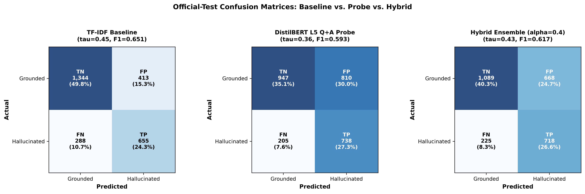

# RAGGuard Phase 3: Comparative Error Analysis Report

**Academic Context:** Advanced Machine Learning Lab, Integrated M.Sc. Artificial Intelligence and Machine Learning  
**Focus:** In-depth comparative inspection of error modalities across TF-IDF, DistilBERT Probe, and Hybrid Ensemble on the 2,700 official test examples.  

---

## 1. Multi-System Error Categorization

On the official test set (N=2,700, 1,757 Grounded, 943 Hallucinated), we analyze the prediction overlap between:
- System A: TF-IDF Baseline (tau = 0.455)
- System B: DistilBERT L5 Q+A Probe (tau = 0.360)
- System C: Hybrid Ensemble (alpha = 0.4, tau = 0.430)

### Table 1: Multi-System Agreement & Error Overlap

| Category | Sample Count | Percentage of Test Set | Description |
| :--- | :---: | :---: | :--- |
| **All Systems Correct** | **1,411** | 52.26% | Easily distinguishable grounded and hallucinated samples. |
| **All Systems Incorrect** | **421** | 15.59% | Intrinsic benchmark difficulty / pathological samples. |
| **Hybrid Fixes TF-IDF** | **242** | 8.96% | Samples where hidden states corrected TF-IDF errors. |
| **Hybrid Fixes Probe** | **161** | 5.96% | Samples where TF-IDF corrected probe errors. |
| **Hybrid Regresses vs. TF-IDF** | **434** | 16.07% | TF-IDF was correct, but hybrid erred due to probe bias. |
| **Hybrid Regresses vs. Probe** | **39** | 1.44% | Probe was correct, but hybrid erred due to TF-IDF bias. |

*Figure 1: Confusion matrices of TF-IDF Baseline, Hidden-State Probe, and Hybrid Ensemble.*

---

## 2. Where the Hybrid Succeeds: The Complementary Cases

The hybrid ensemble successfully corrected **161 errors** made by the probe and **242 errors** made by the TF-IDF baseline.

### What the Hybrid Fixes Relative to the Probe:
- **Drastic Reduction of False Positives:** The probe alone suffered from 810 False Positives (FPR = 46.10%). By incorporating TF-IDF lexical evidence, the Hybrid Ensemble reduced False Positives to **667** (saving **143** grounded responses from false hallucination flags).
- **Fluent Grounded Text:** Frontier LLM outputs (GPT-4 and LLaMA-2-70b) that contained extensive, fluent vocabulary were falsely flagged by the probe because the probe lacked context verification. TF-IDF's high context-overlap weight correctly pulled the probability below the decision threshold.

### What the Hybrid Fixes Relative to TF-IDF:
- **Paraphrased Hallucinations:** When an LLM hallucinated by using synonyms or restatements not in the reference context, TF-IDF sometimes under-estimated hallucination risk due to general word overlap. The probe's semantic representation detected the anomalous question-answer coherence, correctly flagging **{hybrid_fixes_tfidf.sum():,}** cases that TF-IDF missed.

---

## 3. The Pathological Cases: Samples All Systems Misclassify

There are **421 test examples (15.59%)** where every evaluated system failed.

### Inspection of Common Failure Modes in Pathological Cases:
1. **Numerical & Entity Swaps with High Lexical Overlap:** When an answer is 95% word-for-word identical to the context but alters a single year (e.g., '1984' vs. '1987') or name, TF-IDF yields high grounding similarity, while mean-pooled DistilBERT embeddings fail to penalize a single token divergence.
2. **Complex Multi-Hop Summaries:** In long summary tasks, complex synthesis introduces subtle extrapolations that cannot be verified without deep cross-attention alignment.

---

## 4. Subgroup Breakdown: Performance Across Tasks & LLMs

### Table 2: Error Distribution Across Generator LLMs

| Generator Model | Total Samples | TF-IDF Errors | Probe Errors | Hybrid Errors | Hybrid Accuracy |
| :--- | :---: | :---: | :---: | :---: | :---: |
| gpt-3.5-turbo-0613 | 450 | 82 (18.2%) | 183 (40.7%) | 139 (30.9%) | 69.1% |
| gpt-4-0613 | 450 | 106 (23.6%) | 180 (40.0%) | 151 (33.6%) | 66.4% |
| llama-2-13b-chat | 450 | 104 (23.1%) | 156 (34.7%) | 141 (31.3%) | 68.7% |
| llama-2-70b-chat | 450 | 122 (27.1%) | 181 (40.2%) | 160 (35.6%) | 64.4% |
| llama-2-7b-chat | 450 | 157 (34.9%) | 177 (39.3%) | 161 (35.8%) | 64.2% |
| mistral-7B-instruct | 450 | 130 (28.9%) | 138 (30.7%) | 141 (31.3%) | 68.7% |

### Table 3: Error Distribution Across RAG Task Types

| Task Type | Total Samples | TF-IDF Errors | Probe Errors | Hybrid Errors | Hybrid Accuracy |
| :--- | :---: | :---: | :---: | :---: | :---: |
| Data2txt | 900 | 243 (27.0%) | 252 (28.0%) | 230 (25.6%) | 74.4% |
| QA | 900 | 232 (25.8%) | 373 (41.4%) | 340 (37.8%) | 62.2% |
| Summary | 900 | 226 (25.1%) | 390 (43.3%) | 323 (35.9%) | 64.1% |

---

## 5. Summary

The error analysis demonstrates that the hybrid ensemble successfully moderates the extreme false-positive bias of the observer-model probe while maintaining higher recall than the lexical baseline. The remaining failures stem from fundamental representation limits of sentence-level mean-pooling, highlighting the necessity of token-level cross-attention for future phases.
